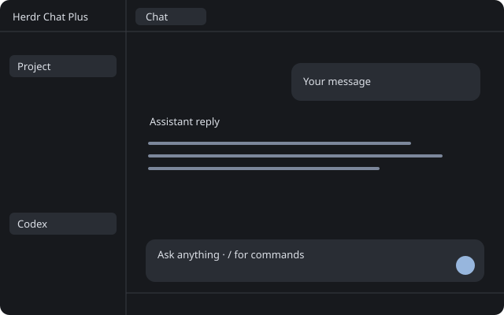

# Herdr Chat Plus

A native [Herdr](https://herdr.dev) layout for existing Claude Code and Codex terminals. **Chat / TUI** switches how you see the same running terminal. Chat does not create another shared terminal pane; TUI keeps Herdr's normal splits.

Based on [naruse/herdr-chat](https://github.com/naruse/herdr-chat). The original MIT license and author attribution are retained. Herdr Chat Plus is an independent layout project, not an official Herdr distribution.



## Features

- Catppuccin light and dark themes, Markdown replies, attachments, image zoom/pan, search, slash commands, and model/effort controls.
- One Chat view per terminal, with the owning pane and machine used to resolve remote addresses and session logs. Codex fork history and resume/new transitions are handled conservatively; [identity details](docs/codex-title-identity.md).
- A local follow-up queue with Instant, remove, explicit failure retry, and attachments. Failed direct sends stay separate from queued follow-ups.
- A read-only file sidebar with Markdown Preview / Source and Diff / File. Change cards open the turn's recorded diffs, with file headers that push out as you scroll; hovering a changed file previews its diff while the sidebar is closed.
- Incremental history loading beyond the initial 4 MiB, grouped command activity, colored diffs, visible terminal prompts and usage-limit errors, and 5h/7d rings that show remaining quota.
- Separate New Chat and New Space actions; Chat/TUI selection is remembered per terminal. Hidden Chat views suspend expensive work.

## Install and update

Requirements: Herdr App, Python 3.9+, and Claude Code or Codex on the machine running the agent. Development checks currently use **Herdr App 0.1.15 on macOS**. This is a development snapshot, not a validated cross-platform release.

The repository is currently private; cloning requires access to `XD-Open-Jarvis/herdr-chat-plus`:

```sh
git clone https://github.com/XD-Open-Jarvis/herdr-chat-plus.git
cd herdr-chat-plus
python3 scripts/install.py --install
```

For a checkout already on this machine:

```sh
python3 scripts/install.py --diagnose  # read-only file/routing checks
python3 scripts/install.py --update   # back up and replace the layout/mod files
```

Read `~/.config/herdr-app/AGENTS.md` before installing. `--install` refuses existing Chat names. `--update` backs up replaced files, preserves a conflicting New Chat shortcut, and selects the Chat layout. `--home PATH` or `HERDR_APP_HOME` chooses another app home. Without a mode, the installer only prints a dry run.

The seven mods and the runtime layout still use their established names: `chat`, `chat-file`, `chat-preview`, `chat-pane`, `chat-tabs`, `spaces-chat`, and `agents-chat`. This is intentional for existing customized installations. **The package shares the `chat` namespace with the original layout; they cannot be installed side by side under those names.** No session migration or core-document reset is part of the installer. Another Mac must separately configure its connection to the terminal's machine.

## Development

Node.js 22+ and Python 3.9+ are needed for local checks. There are no npm dependencies.

```sh
python3 scripts/check.py           # structure, syntax, shared copies, JS/Python tests
python3 scripts/check.py --native  # also check all seven mods in the installed Herdr runtime
```

See [CONTRIBUTING.md](CONTRIBUTING.md) for module ownership and shared-code rules, [RECIPE.md](RECIPE.md) for the layout contract, and the [release checklist](docs/release-checklist.md) for remaining manual validation. The version and mod manifest live in [package.json](package.json); `private: true` prevents accidental npm publication and does not control GitHub visibility.

## Limits

- Transcript adapters currently support Claude Code and Codex. Other agents, including Grok, need an adapter.
- Existing Codex terminals may require `/status` to establish identity. Chat does not choose the newest log as a substitute for identity.
- Queue state is local to this Chat client. Automatic delivery requires Herdr running; other clients have separate queues.
- File previews are read-only and refresh on request. Diff is the historical patch recorded in the transcript; File is current disk content. Source previews stop at 400,000 characters. Line references are displayed in the path but do not yet move the code editor cursor.
- Native terminal drawing, scrollback and multi-client TUI behavior belong to Herdr App/Core; this layout cannot replace their renderer.

## Attribution

Original Herdr Chat by naruse, under [MIT](LICENSE). Catppuccin palettes retain their [MIT notice](docs/CATPPUCCIN-LICENSE). Earlier screenshots and documentation are preserved in the [historical README archive](docs/upstream-original.md), rather than presented as the current UI. Changes in this development version are listed in [CHANGELOG.md](CHANGELOG.md).
